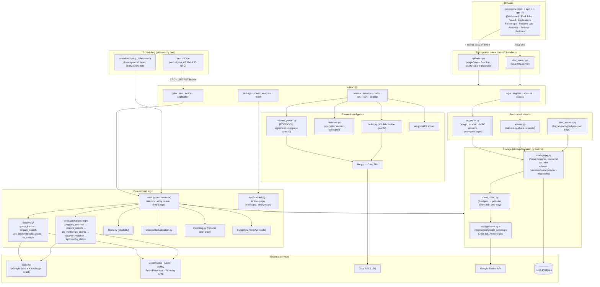

# Architecture

Updated 2026-10-12 for the source-priority discovery work (uncommitted on top of `4cedc3b`; not deployed). First written at `9f4b6b3`. Nothing below is aspirational. The app is branded **Apply Seamlessly** in the UI (`b059d03`).

**Production today:** Vercel (`job-finder-obs14.vercel.app`) in multi-user mode on Neon Postgres. Migrations 0001-0004 are applied and `rls_status` returns `enforced`. Scheduling is not working: see the Scheduling bullet below.

## Overview

The app is a Python monolith with no separate backend framework (no Flask/Django/FastAPI) — `routes/*.py` modules implement raw HTTP handlers shared between two entry points:

- **`api/index.py`** — the single Vercel serverless function. Vercel's Hobby plan caps a project at 12 functions, so every `/api/<name>` request is routed, via `vercel.json` rewrites, to this one function, which dispatches by name to `routes/<name>.py`.
- **`dev_server.py`** — a local `http.server`-based dev server that dispatches to the *same* `routes/<name>.py` handler classes, so local behavior and production behavior cannot drift apart.

The frontend (`public/index.html`, `app.js`, `app.css`) is static, vanilla JS, no build step, served directly by Vercel or the dev server. It authenticates with a Bearer session token (not cookies — the README notes this sidesteps CSRF), not by server-rendered pages.

There is no separate "backend service" to deploy — the dashboard and API are the same Vercel deployment.

## Job pipeline (the core domain logic)

`main.py` is the orchestrator, invoked either from the CLI, from `routes/run.py` (dashboard-triggered or cron-triggered), or from the local systemd timer:

1. **Discovery** (`discovery/`, orchestrated by `main.plan_tasks` / `main.discover`). Five providers, described in "Discovery sources" below, produce unverified candidates in one bounded thread pool until the discovery share (40%) of `RUN_TIME_LIMIT` is used. A best-effort HR-contact search (`hr_search.py`) runs after verification. All outbound HTTP goes through `http_client.py`: retry and backoff, a per-host politeness throttle (thread-safe), robots.txt checks, a refusal to fetch job-board URLs, and secret redaction in logs.
2. **Filtering** (`filters.py`) — India/remote-for-India eligibility, fresher/experience bounds, age-of-posting.
3. **Deduplication** (`storage/deduplication.py`) — merges duplicate postings across sources, preferring the more-verified copy.
4. **Verification** (`verification/pipeline.py`) — an 8-gate sequential check (employer identity via Google Knowledge Graph/Wikidata → official website → careers page on that same domain → ATS-board link trust → exact vacancy/title/location/requisition-ID match → real open/closed determination → apply-URL ownership → eligibility), producing one of exactly four statuses: `VERIFIED`, `NEEDS_REVIEW`, `REJECTED`, `CLOSED`. Evidence is stored durably in the Postgres `verification` table (`status`, `reason`, `checks` JSON per gate, `retry`, `attempts`, `next_check`). It is also appended to `logs/verification-<date>.jsonl`, one JSON object per job: `run, dry_run, job_id, status, title, company, location, experience, listing_url, careers_url, apply_url (only if Verified), notes, evidence`. On Vercel that file is in `/tmp` and is lost after each invocation, so the table is the record to review. If a run hits its time limit, jobs not yet verified are saved as Needs Review with retry set (`1edf5d0`). Jobs that fail for a transient reason (budget exhausted, network error) go into a retry queue (`storage/store.py`: 5 jobs/run, 3 attempts, 12h apart).
5. **Matching** (`matching.py`) against the user's resume profile — a relevance score, kept deliberately separate from verification confidence.
6. **Persistence** via the storage abstraction (below).
7. **Budget tracking** (`budget.py`) caps SerpApi calls per run and per month, splitting the quota between job search, employer lookups (cached), and HR lookups.

## Discovery sources (source-priority architecture)

Each source is a provider in `main.provider_tasks`. The order, and which providers run, comes from `DISCOVERY_PROVIDERS` (default `company_pages,ats_boards,google_jobs,linkedin,naukri`). Tasks from all providers are interleaved round-robin in that order, so every source gets early slots. The paid SerpApi budget for a run (half the run's allowance) is also shared round-robin by the paid providers.

| Provider | Module | Cost | Finds | Access method |
|---|---|---|---|---|
| `company_pages` | `discovery/company_pages.py` | free (a preferred company not yet identified costs 1 search, max 3 per run) | Vacancies on employers' **official careers pages** and the ATS boards those pages link to | Official site from Knowledge Graph/Wikidata evidence → `careers_search.find_careers` on that domain → employer-linked ATS board APIs, or schema.org `JobPosting` markup on official-domain pages (careers page, ≤3 `rel=next` pages, ≤10 linked vacancy pages) |
| `ats_boards` | `discovery/ats_boards.py` + `boards.json` | free | Curated employer boards (19 today) | Public Greenhouse / Lever / Ashby APIs; SmartRecruiters and Workday searched by the **user's roles**, ≤3 pages each |
| `google_jobs` | `discovery/serpapi_search.py` | 1 search per query | Google Jobs listings; apply links on job boards are dropped unless the board is a trusted portal | SerpApi `google_jobs` |
| `linkedin` | `discovery/platform_search.py` | 1 search per query (`LINKEDIN_QUERIES`, default 2) | LinkedIn job postings indexed by Google | SerpApi Google search `site:linkedin.com/jobs/view …`. **LinkedIn is never fetched**: only Google's result title, link and snippet are read |
| `naukri` | `discovery/platform_search.py` | 1 search per query (`NAUKRI_QUERIES`, default 2) | Naukri postings indexed by Google | Same, with `site:naukri.com/job-listings`. **Naukri is never fetched** |

**Employers and caching.** The `company_pages` employers are:
- the user's preferred companies (Settings → prefer);
- every employer whose official website is already in the company cache. The cache grows as searches resolve new employers.

Employers are crawled least-recently-crawled first, `COMPANY_PAGES_PER_RUN` (default 8) per run. A partly finished run therefore continues next time. Each official domain's careers page and linked boards are cached as `careers|<domain>` in the shared `company_cache` table (public company data only: `careers_url, boards, evidence, checked`) for `CAREERS_TTL_DAYS` (default 7).

**Source labels and tiers** (`discovery/sources.py`):

| Tier | Meaning | Labels |
|---|---|---|
| 1 | company-originated | Company website, Greenhouse, Lever, Ashby, Workday, SmartRecruiters, Jobvite |
| 2 | trusted job platform | LinkedIn, Naukri, Indeed, Glassdoor, Foundit, Shine, … |
| 3 | supplementary | anything else |

`SOURCE_TIERS` (JSON) overrides any label's tier. Tiers express **preference only**. They decide:
- which copy becomes the canonical listing when duplicates merge;
- verification order when time is short;
- a ranking bonus.

They never make a job Verified.

**Provenance.** Every URL a job was seen at is stored in the verification record as `checks.sources = [{label, url, tier, id}]`. `url` is canonical: tracking parameters such as `utm_*`, `trk` and `refId` are dropped, while vacancy parameters such as `gh_jid` and `token` are kept. `id` is source-specific, e.g. `linkedin:3912345678`, `naukri:…` or `greenhouse:board:4001`.

**Deduplication** (`storage/deduplication.py`):
- Duplicates are matched on employer + title + location.
- Two postings with **different employer requisition IDs are never merged**.
- The better-verified copy keeps its status and evidence.
- The best-tier URL becomes the canonical listing; all other URLs are kept as provenance.

**Official labelling.** The dashboard (`routes/jobs.py:source_info`) shows **"Official company posting"** only when verification evidence supports it: the job is Verified, or the exact vacancy was matched in the employer's own system (`vacancy_match` passed). A "Company website" label on a domain not shown to be the employer's is displayed as "Other site (unconfirmed)". The Google Jobs label for an off-board apply link is now "employer-site link (unconfirmed)". It used to say "Company career page", and the ranking had treated that as company-originated.

**Run status.** A run that hit the discovery time share is recorded as `partial (search time limit)`, and one that hit the overall limit as `stopped early (time limit)`. Neither is recorded as `ok`. Per-provider counts are in the run summary: tasks done, candidates, errors, and unsupported boards.

## Storage: two interchangeable backends

`storage/backend.py` selects a backend at runtime based on `STORAGE_BACKEND`/`DATABASE_URL`:

- **Single-user: Google Sheets** (`storage/store.py` + `integrations/google_sheets.py`) — the `Jobs` tab is the database; an `Archive` tab holds cleared jobs (never deleted); service-account auth via `gspread`.
- **Multi-user: Neon Postgres** (`storage/pg.py`, schema in `prisma/schema.prisma`, migrations in `prisma/migrations/`) — every table carries `user_id`; Postgres row-level security is **forced** (even the owning role can't bypass it — migration `0003` creates a separate, deliberately-restricted `app_rls` role for the app to connect as). `accounts.py` handles scrypt password hashing, lockout, HMAC session tokens, and (as of migration `0004`) username login and admin API-key-sharing requests (`access.py`). `user_secrets.py` Fernet-encrypts each user's own SerpApi/Groq keys.
- **`sheet_mirror.py`** — in multi-user mode, optionally mirrors each user's Postgres data into their own Google Sheet tab (`Jobs - <email>`), one-way, best-effort, never reading the tab back.

## Resume intelligence

- `resume_parser.py` extracts text from an uploaded PDF/DOCX, validating file signature, size (3MB), and page count (10) server-side.
- `llm.py` sends the extracted text to the **Groq API** to build a structured, editable candidate profile; `resumes.py` stores named, encrypted resume versions (up to 20).
- `matching.py` scores a job against the profile (required skills, experience, title, location/mode, preferred skills, education), capping the score at 25 if a hard eligibility requirement (experience/location) fails.
- `ats.py` scores a resume against a job description using a separate ATS-style keyword/structure heuristic.
- `tailor.py` produces tailoring suggestions and a draft, with explicit anti-fabrication guards (rejects invented numbers, requires bullet suggestions to originate from a real bullet, flags unused keywords as "add only if true").

## LaTeX resumes (per-job edits, copy / Overleaf / PDF)

Module: `latex_resume.py`, with routes `/api/tailor` and `/api/resumes`.

**Your own `.tex`.** Upload a `.tex` file or paste the source. It is stored exactly as written, encrypted like every resume version, with `format: "latex"`. The AI profile, ATS score and matching read its plain text (`to_plain`).

**Per-job edits.** `propose_edits` asks the AI for exact find/replace edits to *your* source. `check_edit` keeps an edit only if all of these hold:
- the text to change occurs exactly once;
- the replacement adds no LaTeX command, and never one that touches files, runs code or defines macros (`\input`, `\write`, `\def`, `\usepackage`, …);
- braces stay balanced;
- it adds no new numbers.

New skills are flagged and left unticked by default. You tick the edits you want.

**What tailoring may touch** (`editable_lines`, enforced in `check_edit` and `check_addition`):
- **May change:** experience/project bullets, and the summary and skills sections.
- **Never changes:** the header; education, certification, award and other locked sections; job titles, companies, places, dates; project names; headings. Edits there are rejected even if the AI proposes them.
- This works for the standard template and for the user's own LaTeX (sections are recognised by their headings).
- Keyword-only edits may use the job's keywords, the built-in skill list and the skills the user lists themselves.

**New bullets** (at most 4 per job) are allowed only when grounded in the resume, enforced by `check_addition`:
- each must quote *evidence* copied from the resume;
- every word must come from that evidence, the bullet it joins, the job's keywords, a list of action verbs or a list of generic nouns;
- no new numbers and no LaTeX.

It is inserted under an existing bullet using that line's own formatting (`\item`, `\resumeItem{}`, indentation), so the layout is unchanged. New bullets are unticked until the user confirms them. `apply_edits` re-checks every edit on the server before applying it, so the layout never changes.

**My Profile (the standard source for every user's resume).** The dashboard page *My Profile* has fixed fields:
- personal details and summary;
- education: school, place, degree, dates, score, details;
- experience: role, company, place/mode, dates, bullets;
- projects: name, tech, dates, bullets;
- skill lines, certifications, achievements and extra sections.

How it works:
- `clean_profile` validates it, and it is stored encrypted (`_resume_profile`).
- Saving creates or updates one version, "Resume from my profile" (`resumes.save_profile`), built by `profile_to_details` → `render_details`.
- *Import from an uploaded resume* maps any saved resume onto these fields (`details_to_profile`) for the user to check.
- `check_profile` asks for what's missing: email, phone, company, dates, bullets.

**Standard format.** The layout is taken from the owner's own LaTeX template:
- A4, 11pt, 0.5in/0.45in margins, line spacing 1.05;
- bold name, small italic tagline, teal links;
- a rule between sections (`\sectiondivider`) and large bold headings;
- bold role with the company on the right, and dates below;
- tech names bold inside bullets (the built-in skill list plus the user's own skills, `own_terms`), and bold certificate names.

Times is used where available (Overleaf), Latin Modern otherwise (in-browser engine). It is plain LaTeX with no titlesec/enumitem.

**Check your details.** After a PDF/DOCX upload or a pasted resume:
- `parse_details` reads it into structured details: name, tagline, contacts, and sections of entries (title, company/place, second line, dates, bullets), lines and text.
- `check_details` lists what the user should confirm: missing email/phone/Education/Skills, a company joined to a job title, missing dates.
- The user corrects everything in the "Check your details" form.
- `clean_details` validates the input. The details are stored encrypted with the version, and the version's text becomes the corrected text.
- From then on the template (`render_details`), ATS score, matching and tailoring all use the corrected details. `resumes.tex_for` picks the user's own LaTeX, else the checked details, else the raw text.

**Every resume is tailored the same way.** A PDF/DOCX resume is first placed into the default template from its *original* text: deterministic, no AI. It then gets the same keyword-only edits and grounded new bullets as a LaTeX resume. The older AI "full rewrite" draft is no longer used for tailoring. In a live preview it merged two jobs into one line.

**Plain-text resumes: the default layout for every user without their own `.tex`.** `to_latex` places the text into a fixed template modelled on the owner's sample resume:
- centred name in capitals, italic tagline, one contact line separated by "•";
- capitalised section headings, each with a full-width rule;
- a bold role or school on the left with its date range or place right-aligned;
- compact bullets in Latin Modern.

It is ATS-friendly:
- single column, standard headings;
- `\pdfgentounicode` and `\pdfinterwordspaceon`, so extracted text has real spaces;
- no hyphenation, left-aligned text.

**One-page fit.** There are five spacing levels (`\def\fitlevel{0..4}`: font size, margins and gaps). `fit_level` estimates the level from the resume's length; that estimate is what Overleaf gets. *PDF in browser* compiles from level 0 upwards and keeps the roomiest level that fits on one page. All of this is plain LaTeX, so it compiles in the browser engine. No AI is involved.

**Getting the result out:**
- Copy LaTeX.
- Download `.tex`.
- **Open in Overleaf:** Overleaf's documented form POST to `https://www.overleaf.com/docs` with `encoded_snip`. This is the only change to the main security policy (`form-action`).
- **PDF in browser:** `public/pdf.html` with Siglum (TeX Live 2025 in WebAssembly, MIT). It has its **own** security policy allowing only `cdn.jsdelivr.net`, `cdn.siglum.org`, `blob:` and `wasm-unsafe-eval`. It receives the LaTeX by `postMessage` from an app window on the same site and never reads the session. Fetching packages from third-party proxies is switched off, so the engine has a fixed package set. titlesec, enumitem, marvosym, ragged2e and paracol are **not** included, and Jake's Resume uses the first three. `pdf.js` checks the `\usepackage` list against the engine's file list before compiling. If anything is missing, it names the packages and offers Open in Overleaf. The generated template uses plain LaTeX only, so it always compiles in the browser.

**Recommended version.** Saving a tailored version for a job stores that job's role words and skills. For a new job, `resumes.recommend` picks the closest tailored version (60% role words with seniority words ignored, 40% skill overlap, threshold 50%). It shows that version's ATS score for this job next to the selected resume's score. This runs locally, with no AI call.

## Cross-cutting concerns

- **Config** (`config.py`) validates all required env vars at startup and fails closed with a clear error, never logging values.
- **Secret handling** — redaction filter on all log output (`http_client.py`); per-user secrets Fernet-encrypted at rest; `/api/health` reports config *presence* (booleans) only.
- **Scheduling.** Exactly one of two paths is meant to be active: a local **systemd timer** (`scheduler/setup_schedule.sh`) running `main.py`, or **Vercel Cron** (`vercel.json`) calling `/api/run` with a `CRON_SECRET` bearer token. In multi-user mode the cron handler now calls `routes/run.py:cron_all_users()`. It goes through users least-recently-searched first (`backend.active_users`). Each user gets a time slice (`CRON_USER_SECONDS`, default 110 s) inside `CRON_TIME_BUDGET` (270 s), and runs with their own saved settings, key, store and lock. Users who don't fit are deferred to the next slot. This is implemented and tested but **not deployed**: production still runs the old code, and `CRON_SECRET` on Vercel is unconfirmed.

## Architecture diagram

## What does NOT exist (confirmed by code inspection)

- No separate database for job data in single-user mode — Google Sheets *is* the database.
- No message queue, no background worker process — runs happen synchronously within a single `main.py` invocation, bounded by the Vercel 240s self-imposed budget (300s platform limit).
- No notification provider (email/SMS/push) is wired up anywhere in the code — "Follow-ups" surfaces reminders in the dashboard only, it does not push anything to the user.
- No LinkedIn or Naukri scraping or access-control bypass anywhere. `hr_search.py` and `platform_search.py` only read Google's own result titles and snippets, and `http_client` refuses to fetch job-board URLs.
- No client-side framework/build step for the frontend — plain HTML/CSS/JS.
